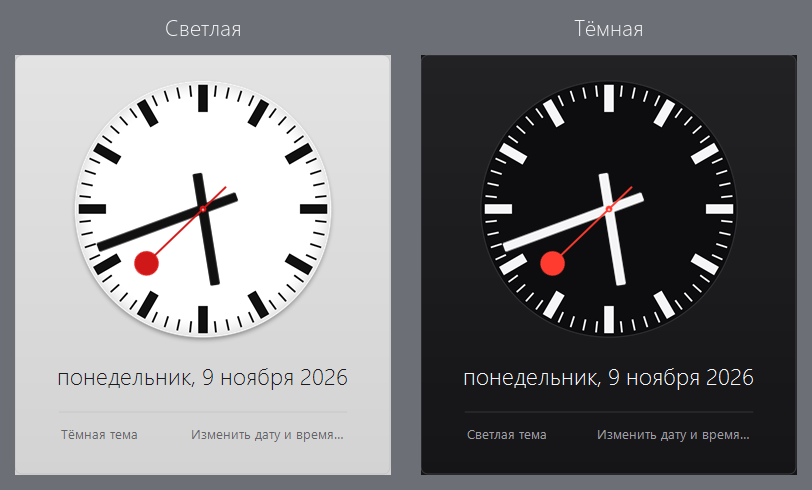
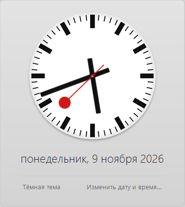
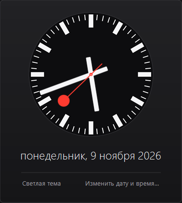

# iOS6Clock

Аналоговые часы в стиле iOS 6 вместо стандартного окна часов Windows.
Кликаешь по времени в трее — открывается циферблат SBB/Mondaine с датой
и ссылкой на настройку времени.



## Возможности

- Циферблат в стиле iOS 6 (SBB/Mondaine), плавная секундная стрелка.
- Светлая тема (серый фон) и тёмная (тёмный циферблат со светлыми стрелками).
- Переключение темы прямо в окне или из меню, выбор запоминается.
- Автозагрузка при входе в систему.
- Не изменяет системные файлы Windows и не требует прав администратора.

## Требования

- Windows 7 SP1 или новее (32 или 64 бита).
- .NET Framework 4.0 или новее. На Windows 7 обычно уже установлен; если
  нет — поставьте [.NET Framework 4.8](https://dotnet.microsoft.com/download/dotnet-framework/net48).

## Установка

1. Скачайте `iOS6Clock-1.2.zip` со страницы [Releases](../../releases).
2. Распакуйте в любую папку, например `C:\Program Files\iOS6Clock`.
3. Запустите `iOS6Clock.exe` — в трее появится иконка часов.

Файл не подписан цифровой подписью, поэтому SmartScreen в Windows 10/11
может показать предупреждение — «Подробнее» → «Выполнить в любом случае».
Исходный код открыт, его можно собрать самостоятельно (см. ниже).

## Использование

- **Клик по часам в трее** — открыть окно. Закрыть: клик мимо окна, `Esc`
  или повторный клик по часам.
- **Правый клик** по часам или иконке — меню: «Открыть часы»,
  «Тёмная тема», «Запускать при входе», «Выход».
- **Ссылка внизу окна** переключает тему: «Тёмная тема» / «Светлая тема».
- **«Изменить дату и время…»** открывает системные настройки.

| Светлая | Тёмная |
| --- | --- |
|  |  |

## Сборка

Visual Studio не нужна: используется `csc.exe` из состава .NET Framework.

```powershell
powershell -ExecutionPolicy Bypass -File .\build.ps1
```

Готовый файл появится в `dist\iOS6Clock.exe`.

## Как это работает

В Windows 7 часы в области уведомлений — отдельное окно класса
`TrayClockWClass`. Программа находит его, кладёт сверху невидимое
окно-перехватчик и по клику показывает своё окно. Системные файлы
не изменяются.

Ограничения:

- системные часы должны быть видны (не отключены в настройках области
  уведомлений);
- при автоскрытии панели задач перехват выключается, иначе нельзя было бы
  вызвать панель;
- если часы заменены сторонним твикером, клик может не перехватываться —
  окно открывается через иконку в трее.

Лог ошибок: `%LOCALAPPDATA%\iOS6Clock\error.log`.

## Структура проекта

```
src/      исходники на C#
res/      картинки циферблата и иконка (встраиваются в exe)
tools/    Python-скрипты, которыми нарисованы картинки (Pillow, numpy)
docs/     скриншоты для README
build.ps1 сборка exe
```

## Лицензия

MIT — см. [LICENSE](LICENSE).

Дизайн циферблата — SBB (Швейцарские железные дороги) / Mondaine; в iOS 6
он использован Apple по лицензии. Проект не связан с Apple, SBB или Mondaine.
